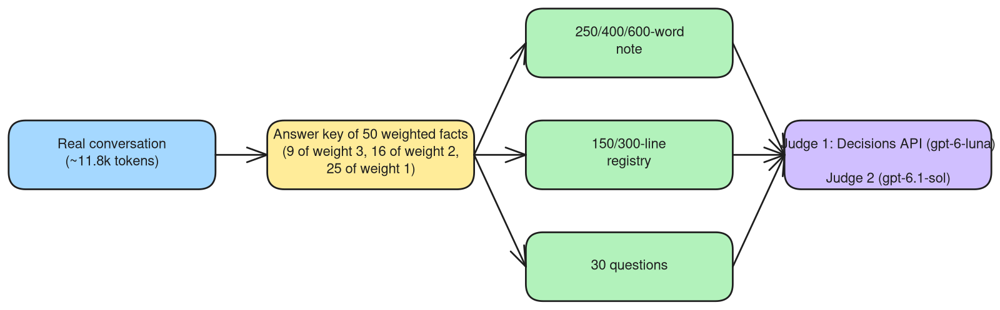

<!-- TODO(hero): assets/hero.png is an original illustration in progress (bots working as a team; no official Grok logo). -->
<p align="center">
  
</p>

<h1 align="center">Memory Outside the Chat</h1>

<p align="center">
  <strong>Short handoffs and a registry with source IDs for long AI-agent chats</strong><br>
  A hands-on tutorial, with scripts to replicate, by Glaucia Lemos.
</p>

<p align="center">
  🇺🇸 <strong>English</strong> · 🇧🇷 <a href="README.pt-br.md">Português</a>
</p>

<p align="center">
  <a href="https://www.python.org/downloads/"></a>
  <a href="https://platform.openai.com/"></a>
  <a href="https://mem0.ai"></a>
  <a href="https://obsidian.md"></a>
  <a href="LICENSE.md"></a>
  <a href="https://github.com/glaucia86/grok-bots-handoff-lab/actions/workflows/ci.yml"></a>
</p>

> **Your AI chat does not need to remember everything. It needs to know where to look.**

> **Status: draft.** The numbers come from a single real conversation of about 11.8k tokens, with one run per condition and automatic judges: preliminary evidence, not proof. Steps 4.1 to 4.6 were executed once with the synthetic conversation (step 4.4, Mem0, with a separate test `user_id`).

## Contents

1. [What this is](#what-this-is)
2. [Quick start](#quick-start)
3. [How to use this tutorial](#how-to-use-this-tutorial)
4. [Run locally](#run-locally)
5. [How it works](#how-it-works)
6. [Results](#results)
7. [Limits](#limits)
8. [Part 2](#part-2)
9. [Tools used](#tools-used)
10. [Repository layout](#repository-layout)
11. [About me](#about-me)
12. [Contributing](#contributing)
13. [Acknowledgements](#acknowledgements)
14. [License](#license)

## What this is

Long chats with AI agents get slower, more expensive and less reliable as they grow, and when they get too big the platform summarizes them for you, without asking what matters. This tutorial shows a different habit: treat the chat as a disposable cache and keep the state outside it, in a short **state note** that goes into every new chat and a **registry** of one-line items, each pointing to the exact piece of conversation it came from (`fonte: B07`). In the tested conversation, that reached 26 and 25 correct answers out of 30, against 27 and 28 for the full chat, with about a fifth of the tokens. You will build it with a few small Python scripts, and you can measure it on your own conversations.

## Quick start

No account and no API key needed for these three steps. On Windows, use Git Bash or WSL.

1. **Install [Python](https://www.python.org/downloads/) 3.9+** and download this repository (green **Code** button > **Download ZIP**, or `git clone https://github.com/glaucia86/grok-bots-handoff-lab.git`).
2. **Open a terminal in the repository folder and run the offline test:** `python -m unittest discover -s tests`. You should see `OK`.
3. **Cut the example conversation into blocks:** `cd scripts`, `mkdir -p ../saidas`, then `python marcar_blocos.py --conversa ../exemplo/conversa-sintetica.md --saida ../saidas/blocos.md --mensagens 3`. You should see `12 mensagens -> 4 blocos em ../saidas/blocos.md`.

It works. Now follow the [step-by-step tutorial](docs/en/tutorial.md) for the rest: state note, registry, Mem0 and measurement.

## How to use this tutorial

If you have never programmed, read the **step-by-step tutorial** from the top: it explains installing Python, opening a terminal and every command, with the expected output and a troubleshooting section. If you already code, [Run locally](#run-locally) is enough, and [Results](#results) summarizes what was measured. The scripts, their messages and the example files are in Portuguese; that does not change how they run. Every name in [exemplo/](exemplo) (Ana, Bruno, Loja Exemplo and others) is fictional.

- 🇺🇸 [Step-by-step tutorial (English)](docs/en/tutorial.md) · [Methodology](docs/en/methodology.md) · [The 7 tests](docs/en/tests.md)
- 🇧🇷 [Tutorial passo a passo (Português)](docs/pt-br/tutorial.md) · [Metodologia](docs/pt-br/metodologia.md) · [Os 7 testes](docs/pt-br/testes.md)

## Run locally

After the quick start, the full path needs an [OpenAI API key](https://platform.openai.com/api-keys), read **only** from the `OPENAI_API_KEY` environment variable. Never write it in a file. From the `scripts` folder:

```bash
export OPENAI_API_KEY="..."               # PowerShell: $env:OPENAI_API_KEY="..."
python gerar_nota.py --conversa ../exemplo/conversa-sintetica.md --saida ../saidas/nota.md \
    --modelo gpt-6-luna --palavras 400 --formato refinado --modo unica
python gerar_registro.py --blocos ../saidas/blocos.md --saida ../saidas/registro.md --modelo gpt-6-luna --linhas 150
```

Steps 4.4 (Mem0), 4.5 (querying in a new chat) and 4.6 (measuring with your own conversation, including the API cost of each step) are in the [tutorial](docs/en/tutorial.md#step-4-run-the-method).

## How it works


The stack is small, and every piece is optional except the format. **Blocks with IDs** are the raw source: the conversation cut into excerpts of a few messages (3 messages and about 1.7 KB each in the tests), numbered B01, B02 and so on. The **state note**, 60 to 90 lines, is rewritten at every update and answers where we are, what was decided, what is pending with owner and condition, and what comes next. The **day registry**, 150 to 200 lines, has one item per line in the format `- tipo | texto | fonte: B07,B08`, and is never rewritten once saved. It is the same logic as grepping by source IDs in code, and in this conversation a simple BM25 over the items was enough.


To keep the layers off your machine we use [Mem0](https://mem0.ai), always with `"infer": false`, so the text is stored without rewriting and the IDs survive. [Obsidian](https://obsidian.md) is optional, to view the notes as a graph. [Graphify](https://github.com/Graphify-Labs/graphify) was tested but is not part of the recipe for chats (see test 5).


## Results

The short version: a 250-word note alone kept 28% to 40% of the weight of the facts and answered 12 of 30 questions; the note plus registry items plus the source blocks they cite (condition G) answered 26 and 25 of 30, within 1-3 of the full chat, with about 21-22% of the tokens. Graphify as context and model-generated typed IDs did not help. The full tables are below.



<details>
<summary><strong>Show all result tables (tests 1 to 7)</strong></summary>

All numbers below were copied from the tests of October 11 and 12, 2026. Table legend: **Simple** is how many of the 50 answer-key facts the note preserves; **Weighted** weights them by importance (3 critical, 2, 1); **Weight 3** is how many of the 9 critical facts were preserved; **Judge 2** is the count by the second, stricter judge, gpt-6.1-sol; **Conditions** is how many of the 5 approval conditions survived. Details and limits of each test are in [docs/en/tests.md](docs/en/tests.md).

### How much a note preserves (tests 1 and 2)

Free-form note, 250 and 600 words:

| Note | Words | Simple | Weighted | Weight 3 | Judge 2 | Conditions |
|---|---|---|---|---|---|---|
| luna single 250 | 253 | 16/50 | 30% | 1/9 | 7/50 | 0/5 |
| luna chain 250 | 263 | 14/50 | 28% | 1/9 | 7/50 | 1/5 |
| luna single 600 | 405 | 21/50 | 38% | 2/9 | 13/50 | 1/5 |
| sol single 250 | 241 | 19/50 | 40% | 4/9 | 8/50 | 4/5 |
| sol chain 250 | 246 | 15/50 | 36% | 4/9 | 14/50 | 1/5 |
| sol single 600 | 512 | 27/50 | 58% | 6/9 | 25/50 | 2/5 |

Refined 400-word note, with fixed sections, owner and condition:

| Note | Words | Simple | Weighted | Weight 3 | Judge 2 | Conditions |
|---|---|---|---|---|---|---|
| luna single 400 | 356 | 29/50 | 55% | 5/9 | 19/50 | 3/5 |
| luna chain 400 | 511 | 25/50 | 51% | 5/9 | 19/50 | 4/5 |
| sol single 400 | 370 | 24/50 | 54% | 7/9 | 16/50 | 4/5 |
| sol chain 400 | 351 | 25/50 | 53% | 6/9 | 23/50 | 4/5 |

### Larger registry: 150 versus 300 lines (test 3)

| Registry | Lines | Est. tokens | Weighted | Simple | Weight 3 | Conditions | Judge 2 |
|---|---|---|---|---|---|---|---|
| luna note 400 (reference) | 27 | ~760 | 55% | 29/50 | 5/9 | 3/5 | 19/50 |
| sol note 400 (reference) | 34 | ~800 | 54% | 24/50 | 7/9 | 4/5 | 16/50 |
| luna R150 | 142 | ~7,200 | 88% | 44/50 | 8/9 | 3/5 | 43/50 |
| luna R300 | 141 | ~6,800 | 85% | 44/50 | 7/9 | 3/5 | 47/50 |
| sol R150 | 207 | ~7,800 | 85% | 43/50 | 8/9 | 5/5 | 44/50 |
| sol R300 | 322 | ~11,300 | 88% | 44/50 | 8/9 | 5/5 | 48/50 |

The registry recovers 85% to 88% of the weight but, in this conversation, costs almost as much as the chat itself (about 11,800 tokens). It only saves anything if it is queried by search.

### Full chat, note only, note plus search (test 4)

| | A: full chat | B: note only | C: note + search |
|---|---|---|---|
| luna: correct/30 | 27 | 12 | 24 |
| sol: correct/30 | 28 | 12 | 23 |
| luna: weight 3/2/1 | 7/10/10 | 6/4/2 | 7/8/9 |
| sol: weight 3/2/1 | 8/10/10 | 7/4/1 | 8/8/7 |
| Input tokens/question | ~11,164 | 757 (luna) / 843 (sol) | 2,146 (luna) / 2,232 (sol) |

### The best result: registry with source ID (test 6)

| Condition | luna: correct | luna: 3/2/1 | luna: tokens | sol: correct | sol: 3/2/1 | sol: tokens |
|---|---|---|---|---|---|---|
| Full chat | 27 | 7/10/10 | 11,164 | 28 | 8/10/10 | 11,164 |
| Note only | 12 | 6/4/2 | 757 | 12 | 7/4/1 | 843 |
| G0: note + 5 items | 22 | 8/7/7 | 964 | 22 | 8/7/7 | 1,072 |
| E: BM25 on blocks | 21 | 7/9/5 | 2,207 | 22 | 8/9/5 | 2,293 |
| Concept search | 24 | 7/8/9 | 2,146 | 23 | 8/8/7 | 2,232 |
| **G: items + blocks by ID** | **26** | **9**/8/9 | 2,330 | **25** | 8/8/9 | 2,492 |

Condition G came within 1-3 correct answers of the full chat with about 21-22% of the tokens. G0, just the note and 5 items, tied with BM25 using less than half the tokens.

### What did not work

In test 5, Graphify with a model, used as context, got 11 and 13 of 30 right, against 21 and 22 for a simple BM25, because node labels do not carry conditions and owners. In test 7, model-generated typed IDs (decision, pending, fact, open question) did not improve retrieval and cost about 7 to 15 times more to generate (7.5 to 13.9 times for the registry; 8.1 and 15 counting the typed note):

| Condition | luna | luna: tokens | sol | sol: tokens |
|---|---|---|---|---|
| G0 (test 6) | 22 / 18 | 964 | 22 / 21 | 1,072 |
| **G (test 6)** | **26 / 24** | 2,330 | **25 / 25** | 2,492 |
| T0: typed note + items | 18 / 15 | 3,465 | 25 / 24 | 4,647 |
| T: + hop + blocks | 21 / 20 | 4,970 | 24 / 23 | 6,402 |
| T0c: 400-word note + typed items | 18 / 16 | 1,078 | 22 / 21 | 1,212 |
| Tc: + hop + blocks | 22 / 18 | 2,583 | 23 / 22 | 2,967 |

</details>

## Limits

It was one conversation of about 11.8k tokens, one run per condition, questions generated by a model from the same facts that generated the registry, and automatic judges with no human review. Differences of 1 to 4 correct answers may be noise, including G's advantage over BM25. The answer key was extracted by a third model and saturates near 88%. Only 4 questions test approval conditions. The registries were not checked for hallucination, and the ID check is approximate. There is no measurement of the money cost of daily operation. Graphify was tested only on chat; in code repositories it probably does better, but that is an untested hypothesis. Condition C ("concept search") is not reproducible with the scripts in this repository; its numbers are a reference.

## Part 2

The most important missing test uses questions written by hand, without looking at the answer key. After that comes a 50k to 100k-token chat, where the savings should really show, and human review of a sample of about 10 answer-key facts. Also open: repeating runs to measure noise, testing Graphify's `explain` and `path` and a test on a code repository, measuring several agents writing to and searching Mem0, and comparing agents' native memory with the external handoff.

## Tools used

| Tool | Role here |
|---|---|
| [Python](https://www.python.org/downloads/) 3.9+ | Runs the scripts (standard library only) |
| [OpenAI API](https://platform.openai.com/) · [API keys](https://platform.openai.com/api-keys) | Notes, registry, answers and judges ([Decisions API docs](https://developers.openai.com/api/docs/guides/decisions)) |
| [Mem0](https://mem0.ai) · [dashboard](https://app.mem0.ai) | Stores the layers outside the machine, with `"infer": false` |
| [Obsidian](https://obsidian.md) (optional) | Views the exported notes as a graph |
| [Git](https://git-scm.com/downloads) (includes Git Bash on Windows) | Downloads the repository and runs the Unix commands on Windows |
| [VS Code](https://code.visualstudio.com/) (optional) | A friendly editor with a built-in terminal |
| [Graphify](https://github.com/Graphify-Labs/graphify) | Tested in test 5; not part of the recipe |

## Repository layout

```
README.md / README.pt-br.md   this page, in English and Portuguese
docs/en/                      tutorial, methodology and the 7 tests (English)
docs/pt-br/                   the same, in Portuguese
diagramas/                    PNG, SVG and Excalidraw sources (Portuguese labels)
diagramas/en/                 the same diagrams with English labels
scripts/                      Python scripts (standard library only)
tests/                        offline test, no API key needed
exemplo/                      SYNTHETIC conversation, blocks, sample handoff and handoff template
```

Every name in [exemplo/](exemplo) (Ana, Bruno, Loja Exemplo and others) is fictional.

## About me

<div align="center">
  <a href="https://github.com/glaucia86"></a>

  <h3>Glaucia Lemos</h3>
  <p><strong>Principal Software Engineer · Microsoft MVP · Codex Ambassador</strong></p>
  <p>I work with AI and software engineering, building <a href="https://github.com/glaucia86/repocheckai">applications</a> and exploring <a href="https://github.com/glaucia86/palestra-sdd">AI coding agents</a> with JavaScript and TypeScript. Formerly at Microsoft, I share practical knowledge through open-source projects, talks and technical content.</p>

  <p>
    <a href="https://www.linkedin.com/in/glaucialemos"></a>
    <a href="https://x.com/glaucia_lemos86"></a>
    <a href="https://www.youtube.com/@GlauciaLemos"></a>
    <a href="https://www.instagram.com/glaucia.lemos.dev"></a>
  </p>
  <p>
    <a href="https://github.com/glaucia86"></a>
    <a href="https://www.twitch.tv/glaucia_lemos86"></a>
    <a href="https://dev.to/glaucia86"></a>
  </p>
  <p><a href="https://linktr.ee/glaucia_lemos86">Linktree</a></p>
</div>

## Contributing

Issues and pull requests are welcome, especially reproductions on your own conversations. Read [CONTRIBUTING.md](CONTRIBUTING.md) first: never commit keys or real conversation data, and every number needs a source.

## Acknowledgements

To Safi Shamsi, for the feedback on Graphify.

## License

[MIT](LICENSE.md).
