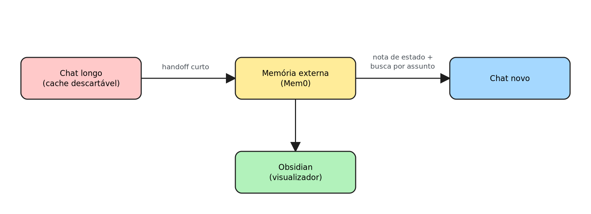
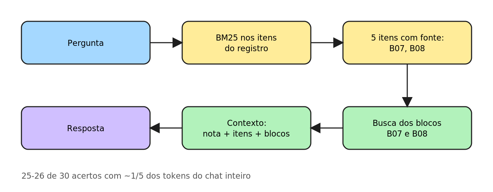

<h1 align="center">Memória fora do chat</h1>

<p align="center">
  <strong>Handoffs curtos e registro com IDs de origem para chats longos de agentes</strong><br>
  Tutorial prático, com scripts para replicar, por Glaucia Lemos.
</p>

<p align="center">
  🇺🇸 <a href="README.md">English</a> · 🇧🇷 <strong>Português</strong>
</p>

<p align="center">
  <a href="https://www.python.org/downloads/"></a>
  <a href="https://platform.openai.com/"></a>
  <a href="https://mem0.ai"></a>
  <a href="https://obsidian.md"></a>
  <a href="LICENSE.md"></a>
  <a href="https://github.com/glaucia86/grok-bots-handoff-lab/actions/workflows/ci.yml"></a>
</p>

> **Status: tutorial de pesquisa preliminar.** Os números vêm de uma única conversa real de cerca de 11,8 mil tokens, com uma rodada por condição e juízes automáticos. Leia como evidência preliminar, não como prova.
>
> **Status da verificação.** O teste offline e o passo 4.1 foram executados e passam. Os passos 4.1 a 4.6 foram executados uma vez com a conversa sintética (o passo 4.4, Mem0, com um `user_id` de teste separado).

## Sumário

1. [Por que isto existe](#por-que-isto-existe)
2. [O que você vai aprender](#o-que-você-vai-aprender)
3. [Como usar este tutorial](#como-usar-este-tutorial)
4. [Rodar localmente em cinco minutos](#rodar-localmente-em-cinco-minutos)
5. [A ideia em uma imagem](#a-ideia-em-uma-imagem)
6. [Resultados](#resultados)
7. [Limites](#limites)
8. [Parte 2](#parte-2)
9. [Ferramentas usadas](#ferramentas-usadas)
10. [Estrutura do repositório](#estrutura-do-repositório)
11. [Quem sou eu](#quem-sou-eu)
12. [Como contribuir](#como-contribuir)
13. [Agradecimentos](#agradecimentos)
14. [Licença](#licença)

## Por que isto existe

Quando você conversa com um agente por muitos dias no mesmo chat, o histórico só cresce, e cada resposta precisa ler esse histórico de novo. Em planos com cota de uso, isso aparece como uma cota que acaba mais cedo. Há também um problema de qualidade: modelos com contextos longos tendem a usar melhor o começo e o fim do texto e pior o meio ([Liu et al., "Lost in the Middle", 2023](https://arxiv.org/abs/2307.03172)). E há um problema de controle: quando o chat fica grande demais, a plataforma resume sozinha o que veio antes, e você não escolhe o que entra no resumo.

A tese deste tutorial é que o chat é um cache descartável e o estado mora fora. A crítica comum é que resumos perdem informação, e os testes concordam: uma nota de 250 palavras guardou de 28% a 40% do peso dos fatos, e sozinha a nota respondeu 12 de 30 perguntas. O que funcionou foi separar o estado em camadas e buscar só o necessário. Uma **nota de estado** curta sempre entra no chat novo. Um **registro do dia** com itens atômicos fica fora e é consultado por busca, e cada item aponta para o trecho bruto de onde saiu, como `fonte: B07`. É a mesma lógica de um grep por IDs de origem em código. Na conversa testada, esse método chegou a 26 e 25 acertos em 30 perguntas, contra 27 e 28 do chat inteiro, com cerca de um quinto dos tokens.

## O que você vai aprender

Você vai aprender a cortar uma conversa em blocos com IDs estáveis, a escrever uma nota de estado curta com donos e condições, a montar um registro em que cada linha carrega o ID da sua origem e a guardar tudo no [Mem0](https://mem0.ai) com `"infer": false`, para que texto e IDs sobrevivam sem mudança. Também vai aprender a medir, na sua própria conversa, quanto cada camada realmente preserva, em vez de confiar nos números de alguém, inclusive nestes.

## Como usar este tutorial

Se você nunca programou, comece pelo **tutorial passo a passo**: ele cobre a instalação do Python, como abrir um terminal, como baixar o repositório e cada comando, com a saída esperada e uma seção de problemas comuns.

- 🇧🇷 [Tutorial passo a passo (Português)](docs/pt-br/tutorial.md) · [Metodologia](docs/pt-br/metodologia.md) · [Os 7 testes](docs/pt-br/testes.md)
- 🇺🇸 [Step-by-step tutorial (English)](docs/en/tutorial.md) · [Methodology](docs/en/methodology.md) · [The 7 tests](docs/en/tests.md)

Se você já programa, a próxima seção basta para rodar, e [Resultados](#resultados) resume o que foi medido.

## Rodar localmente em cinco minutos

Você precisa do [Python](https://www.python.org/downloads/) 3.9 ou mais novo; os scripts usam só a biblioteca padrão. No Windows, use Git Bash ou WSL, porque os comandos usam sintaxe Unix. No macOS e no Linux, use `python3` se `python` não funcionar. Primeiro, prove que tudo funciona **sem nenhuma chave**:

```bash
python -m unittest discover -s tests      # esperado: "Ran 4 tests ... OK"
cd scripts
mkdir -p ../saidas                        # saidas/ está no .gitignore
python marcar_blocos.py --conversa ../exemplo/conversa-sintetica.md --saida ../saidas/blocos.md --mensagens 3
# esperado: 12 mensagens -> 4 blocos em ../saidas/blocos.md
```

O caminho completo (nota de estado, registro, Mem0, medição) precisa de uma [chave da API da OpenAI](https://platform.openai.com/api-keys), lida **só** da variável de ambiente `OPENAI_API_KEY`. Nunca a escreva em arquivo.

```bash
export OPENAI_API_KEY="..."               # PowerShell: $env:OPENAI_API_KEY="..."
python gerar_nota.py --conversa ../exemplo/conversa-sintetica.md --saida ../saidas/nota.md \
    --modelo gpt-6-luna --palavras 400 --formato refinado --modo unica
python gerar_registro.py --blocos ../saidas/blocos.md --saida ../saidas/registro.md --modelo gpt-6-luna --linhas 150
```

Os passos 4.4 (Mem0), 4.5 (consulta no chat novo) e 4.6 (medição com a sua conversa, incluindo o custo em cota de cada etapa) estão no [tutorial](docs/pt-br/tutorial.md#passo-4-rodar-o-método).

## A ideia em uma imagem



A pilha é pequena e cada peça é opcional, menos o formato. Os **blocos com ID** são a fonte bruta: a conversa cortada em trechos de poucas mensagens (nos testes, 3 mensagens e cerca de 1,7 KB cada), numerados B01, B02 e assim por diante. A **nota de estado**, de 60 a 90 linhas, é reescrita a cada atualização e responde onde estamos, o que foi decidido, o que está pendente com dono e condição, e qual é o próximo passo. O **registro do dia**, de 150 a 200 linhas, tem um item por linha, no formato `- tipo | texto | fonte: B07,B08`, e nunca é reescrito depois de gravado.



Para guardar as camadas fora da máquina, usamos o [Mem0](https://mem0.ai), sempre com `"infer": false`, para que o texto seja guardado sem reescrita e os IDs sobrevivam. Para visualizar as notas como grafo, o [Obsidian](https://obsidian.md) é opcional. O [Graphify](https://github.com/Graphify-Labs/graphify) foi testado, mas não faz parte da receita para chats (ver o teste 5).


## Resultados

Todos os números abaixo foram copiados dos testes de 11 e 12 de outubro de 2026. Legenda das tabelas: **Simples** é quantos dos 50 fatos do gabarito a nota preserva; **Ponderado** pondera pelo peso (3 críticos, 2, 1); **Peso 3** é quantos dos 9 fatos críticos foram preservados; **Juiz 2** é a contagem pelo segundo juiz, o gpt-6.1-sol, mais rigoroso; **Condições** é quantas das 5 condições de aprovação sobreviveram. Detalhes e limites de cada um em [docs/pt-br/testes.md](docs/pt-br/testes.md).

### Quanto uma nota preserva (testes 1 e 2)

Nota livre, 250 e 600 palavras:

| Nota | Palavras | Simples | Ponderado | Peso 3 | Juiz 2 | Condições |
|---|---|---|---|---|---|---|
| luna única 250 | 253 | 16/50 | 30% | 1/9 | 7/50 | 0/5 |
| luna cadeia 250 | 263 | 14/50 | 28% | 1/9 | 7/50 | 1/5 |
| luna única 600 | 405 | 21/50 | 38% | 2/9 | 13/50 | 1/5 |
| sol única 250 | 241 | 19/50 | 40% | 4/9 | 8/50 | 4/5 |
| sol cadeia 250 | 246 | 15/50 | 36% | 4/9 | 14/50 | 1/5 |
| sol única 600 | 512 | 27/50 | 58% | 6/9 | 25/50 | 2/5 |

Nota refinada de 400 palavras, com seções fixas, dono e condição:

| Nota | Palavras | Simples | Ponderado | Peso 3 | Juiz 2 | Condições |
|---|---|---|---|---|---|---|
| luna única 400 | 356 | 29/50 | 55% | 5/9 | 19/50 | 3/5 |
| luna cadeia 400 | 511 | 25/50 | 51% | 5/9 | 19/50 | 4/5 |
| sol única 400 | 370 | 24/50 | 54% | 7/9 | 16/50 | 4/5 |
| sol cadeia 400 | 351 | 25/50 | 53% | 6/9 | 23/50 | 4/5 |

### Registro maior: 150 contra 300 linhas (teste 3)

| Registro | Linhas | Tokens est. | Ponderado | Simples | Peso 3 | Condições | Juiz 2 |
|---|---|---|---|---|---|---|---|
| luna nota 400 (referência) | 27 | ~760 | 55% | 29/50 | 5/9 | 3/5 | 19/50 |
| sol nota 400 (referência) | 34 | ~800 | 54% | 24/50 | 7/9 | 4/5 | 16/50 |
| luna R150 | 142 | ~7.200 | 88% | 44/50 | 8/9 | 3/5 | 43/50 |
| luna R300 | 141 | ~6.800 | 85% | 44/50 | 7/9 | 3/5 | 47/50 |
| sol R150 | 207 | ~7.800 | 85% | 43/50 | 8/9 | 5/5 | 44/50 |
| sol R300 | 322 | ~11.300 | 88% | 44/50 | 8/9 | 5/5 | 48/50 |

O registro recupera de 85% a 88% do peso, mas, nesta conversa, custa quase o mesmo que o próprio chat (cerca de 11.800 tokens). Ele só economiza se for consultado por busca.

### Chat inteiro, só a nota, nota mais busca (teste 4)

| | A: chat inteiro | B: só nota | C: nota + busca |
|---|---|---|---|
| luna: acertos/30 | 27 | 12 | 24 |
| sol: acertos/30 | 28 | 12 | 23 |
| luna: peso 3/2/1 | 7/10/10 | 6/4/2 | 7/8/9 |
| sol: peso 3/2/1 | 8/10/10 | 7/4/1 | 8/8/7 |
| Tokens de entrada/pergunta | ~11.164 | 757 (luna) / 843 (sol) | 2.146 (luna) / 2.232 (sol) |

### O melhor resultado: registro com ID de origem (teste 6)

| Condição | luna: acertos | luna: 3/2/1 | luna: tokens | sol: acertos | sol: 3/2/1 | sol: tokens |
|---|---|---|---|---|---|---|
| Chat inteiro | 27 | 7/10/10 | 11.164 | 28 | 8/10/10 | 11.164 |
| Só nota | 12 | 6/4/2 | 757 | 12 | 7/4/1 | 843 |
| G0: nota + 5 itens | 22 | 8/7/7 | 964 | 22 | 8/7/7 | 1.072 |
| E: BM25 nos blocos | 21 | 7/9/5 | 2.207 | 22 | 8/9/5 | 2.293 |
| Busca por conceitos | 24 | 7/8/9 | 2.146 | 23 | 8/8/7 | 2.232 |
| **G: itens + blocos pelos IDs** | **26** | **9**/8/9 | 2.330 | **25** | 8/8/9 | 2.492 |

A condição G ficou a 1-3 acertos do chat inteiro com cerca de 21-22% dos tokens. O G0, só a nota e 5 itens, empatou com o BM25 usando menos da metade dos tokens.

### O que não funcionou

No teste 5, o Graphify com modelo, usado como contexto, acertou 11 e 13 de 30, contra 21 e 22 de um BM25 simples, porque rótulos de nós não carregam condições e donos. No teste 7, IDs tipados gerados por modelo (decisão, pendência, fato, pergunta em aberto) não melhoraram a recuperação e custaram cerca de 7 a 15 vezes mais para gerar (de 7,5 a 13,9 vezes no registro; 8,1 e 15 contando a nota tipada):

| Condição | luna | luna: tokens | sol | sol: tokens |
|---|---|---|---|---|
| G0 (teste 6) | 22 / 18 | 964 | 22 / 21 | 1.072 |
| **G (teste 6)** | **26 / 24** | 2.330 | **25 / 25** | 2.492 |
| T0: nota tipada + itens | 18 / 15 | 3.465 | 25 / 24 | 4.647 |
| T: + salto + blocos | 21 / 20 | 4.970 | 24 / 23 | 6.402 |
| T0c: nota de 400 + itens tipados | 18 / 16 | 1.078 | 22 / 21 | 1.212 |
| Tc: + salto + blocos | 22 / 18 | 2.583 | 23 / 22 | 2.967 |

## Limites

Foi uma conversa de cerca de 11,8 mil tokens, uma rodada por condição, perguntas geradas por modelo a partir dos mesmos fatos que geraram o registro, e juízes automáticos sem revisão humana. Diferenças de 1 a 4 acertos podem ser ruído, inclusive a vantagem de G sobre o BM25. O gabarito foi extraído por um terceiro modelo e satura perto de 88%. Só 4 perguntas testam condições de aprovação. Os registros não foram conferidos contra alucinação, e a conferência dos IDs é aproximada. Não há medição de custo em dinheiro da operação diária. O Graphify foi testado só em chat; em repositórios de código ele provavelmente rende mais, mas isso é hipótese não testada. A condição C ("Busca por conceitos") não é reproduzível com os scripts deste repositório; os números dela são referência.

## Parte 2

O teste mais importante que falta usa perguntas escritas à mão, sem olhar o gabarito. Depois vem um chat de 50 a 100 mil tokens, onde a economia deve aparecer de verdade, e a revisão humana de uma amostra de cerca de 10 fatos do gabarito. Também ficam em aberto repetir as rodadas para medir o ruído, testar `explain` e `path` do Graphify e um teste em repositório de código, medir vários agentes gravando e buscando no Mem0, e comparar a memória nativa dos agentes com o handoff externo.

## Ferramentas usadas

| Ferramenta | Papel aqui |
|---|---|
| [Python](https://www.python.org/downloads/) 3.9+ | Roda os scripts (só biblioteca padrão) |
| [OpenAI API](https://platform.openai.com/) · [API keys](https://platform.openai.com/api-keys) | Notas, registro, respostas e juízes ([documentação da Decisions API](https://developers.openai.com/api/docs/guides/decisions)) |
| [Mem0](https://mem0.ai) · [painel](https://app.mem0.ai) | Guarda as camadas fora da máquina, com `"infer": false` |
| [Obsidian](https://obsidian.md) (opcional) | Mostra as notas exportadas como grafo |
| [Git](https://git-scm.com/downloads) (inclui o Git Bash no Windows) | Baixa o repositório e roda os comandos Unix no Windows |
| [VS Code](https://code.visualstudio.com/) (opcional) | Editor amigável com terminal embutido |
| [Graphify](https://github.com/Graphify-Labs/graphify) | Testado no teste 5; não faz parte da receita |

## Estrutura do repositório

```
README.md / README.pt-br.md   esta página, em inglês e em português
docs/en/                      tutorial, metodologia e os 7 testes (inglês)
docs/pt-br/                   o mesmo, em português
diagramas/                    PNG, SVG e fontes Excalidraw
scripts/                      scripts em Python (só biblioteca padrão)
tests/                        teste offline, sem chave de API
exemplo/                      conversa SINTÉTICA, blocos, handoff de exemplo e modelo de handoff
```

Todos os nomes em [exemplo/](exemplo) (Ana, Bruno, Loja Exemplo e outros) são fictícios.

## Quem sou eu

<!-- TODO(about-me): aguardando bio da Glaucia. Foto: editada com IA, recortada. -->


**Glaucia Lemos**

*TODO: mini bio, a ser enviada pela Glaucia.*

<br clear="left">

<p>
  <a href="https://www.linkedin.com/in/glaucialemos"></a>
  <a href="https://x.com/glaucia_lemos86"></a>
  <a href="https://www.youtube.com/@GlauciaLemos"></a>
  <a href="https://www.instagram.com/glaucia.lemos.dev"></a>
  <a href="https://github.com/glaucia86"></a>
</p>

## Como contribuir

Issues e pull requests são bem-vindos, principalmente reproduções com as suas próprias conversas. Leia antes o [CONTRIBUTING.md](CONTRIBUTING.md): nunca envie chaves nem dados de conversas reais, e todo número precisa de fonte.

## Agradecimentos

A Safi Shamsi, pelo feedback sobre o Graphify.

## Licença

[MIT](LICENSE.md).
